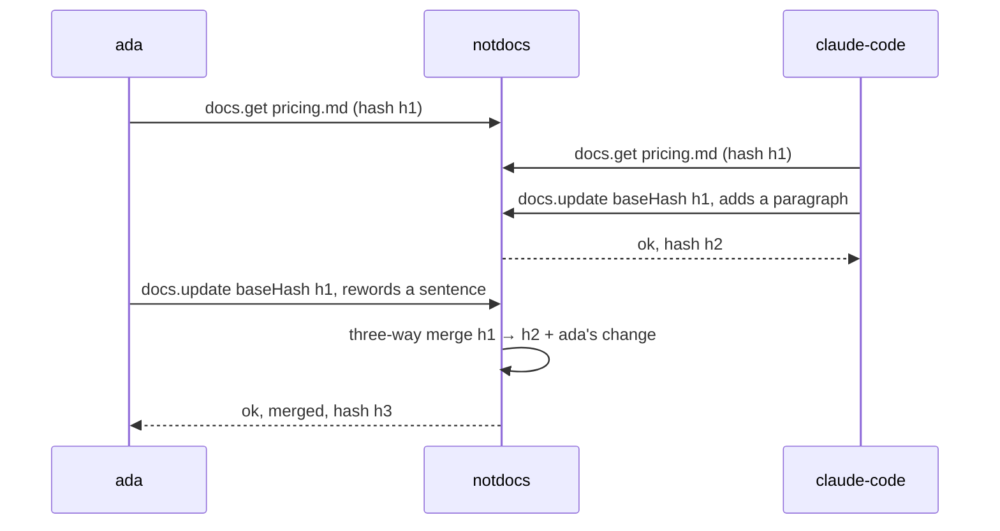

## One branch at a time

The workspace shows one branch and can switch; the branch is part of every document's address in the API, the URL, MCP tool inputs and the change feed. A hosted project's default branch comes from GitHub and follows it. Any other branch is indexed whole the first time it is opened, read again whole after a force-push, and leaves the index when it is deleted on GitHub.

## Merges, not locks

A write carries the hash of the version you loaded. If the file changed underneath you, the edits are three-way merged against that version: frontmatter key by key, the body line by line.

A real conflict, two edits to the same lines, is not written. It comes back as a diff with a recommendation: keep mine, take the file's, or keep editing, graded from what the diff shows.

::::accordions
:::accordion[What is the merge base?]
The content hash the client loaded. The API remembers the text of every version it has seen, keyed by that hash, and uses it as the base when a write arrives with an older hash.
:::
:::accordion[What does an agent see on conflict?]
`docs.update` returns `ok: false` with the conflicts, the current document and the proposed text, instead of writing. The agent can re-read and retry; it never overwrites a person.
:::
:::accordion[Does a no-op save create a commit?]
No. Saves go through the canonical pipeline, so a document that did not change serializes to the same bytes and produces no diff and no commit.
:::
::::
