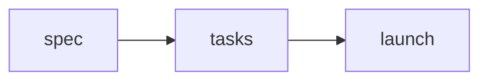

## Writing

The editor is a page over the markdown file. Type markdown and it becomes the block it names; press `/` for the menu of blocks; select text and the formatting toolbar floats over it. The toolbar has headings, bold, italic, strikethrough, inline code, a link, every block the `/` menu inserts (lists, a task list, a quotation, a code block, a callout, a divider, a table, an image), the assistant, a copy of the document's link, undo and redo. Its pin keeps it above the text while you scroll; its × hides it, and the Toolbar choice in Settings or the sidebar's Appearance panel brings it back. The pressed states follow the caret, so a mark shows as on wherever the caret is inside it.

Linking a selection opens a small form under the paragraph: Enter links, Escape gives up. While editing, the block under the pointer takes a soft ground, and code, tables, images and callouts a faint outline, so it is plain that the text can be changed; nothing lights up while reading.

Every save goes through the same markdown pipeline the CLI and the MCP server write with, so a document opened and saved without a change is a zero-line diff.

## Read, edit, source

A document has three faces, switched from the top bar.

| Face | Shortcut | What it is for |
|---|---|---|
| Edit | | The editor. A document you create opens here. |
| Read | ⌘⇧E | The same page without editing: links open on a click, a drawn query, diagram or tree offers **View source** instead of **Edit**, comments work as before. |
| Source | ⌘⇧U | The markdown as text, in the code font. Saving writes it back as markdown; the title and the properties stay as they are. |

Read and Source are remembered in this browser from one document to the next. Source is the way out when the editor cannot write a block back, which its banner says: fix or remove the block as text and save. While a [shared session](editing-together.md) is on, Source shows the text but does not edit it.

## Blocks that draw

Some fenced blocks are drawn rather than shown as code. The file keeps the source of each byte for byte; the drawing is only how the editor and the site show it, and **Edit** under a drawing opens its source.

::::tabs
:::tab[Query]
A fence with the `notdocs` language is a query over the documents on the branch, drawn as a board, a table, a list, a calendar or a gallery. See [Query blocks](query-blocks.md).
:::
:::tab[Mermaid]
A `mermaid` fence is drawn as its diagram, in the workspace's colours, and redrawn when the theme changes. **Edit diagram** opens the source under it; while the source does not parse, the last drawing stays and the reason shows beneath it.

````markdown

````
:::
:::tab[Tree]
A `tree` fence, holding what the `tree` command prints, is drawn as a file tree with folders, files and their notes. **Edit tree** opens the source. Trees drawn with single-dash connectors (`├─ `) are read too; one off the grid shows as written, with a note saying so.

````markdown
```tree
docs/
├── tasks/        one file per task
└── roadmap.md    type: page
```
````
:::
:::tab[HTML]
A block of raw HTML is shown as what it draws, with scripts, event handlers, styles and unsafe links removed, in the editor and on the site alike. **Edit HTML** shows the source under it; a block with nothing left to draw shows its source with a line saying so. Inline HTML in a sentence (`a <kbd>key</kbd>`) is kept as written, so a save does not rewrite it.
:::
:::tab[Code]
Fenced code is syntax-highlighted as you type, and in the assistant's answers, for any language Shiki has a grammar for. Each grammar is fetched the first time a block asks for it, and a page with no code loads none of the highlighter. The colours follow the light or dark theme and are drawn over the text, not written into it.
:::
::::

## Images

Paste an image into a page, drop it there, or pick one with `/image`, and it is stored and shown where the caret was. `notdocs assets upload <file>` and the `assets_upload` MCP tool do the same for an agent and answer the markdown to write. PNG, JPEG, GIF, WebP, AVIF and SVG are stored; the plan sets the size. On the hosted service the browser sends an image straight to the store, so the plan's cap is the only one; an image sent through the API rides inside one request, which a hosted function caps at about 3 MB, and `assets.grant` answers both limits before anything is sent, which is how the web app and the CLI decide.

Where the image goes depends on the deployment. The local daemon commits it to the repository under `<docsRoot>/assets/`, with a hash of its content in the name, and the page references it by its path from the repository root (``), which GitHub and Obsidian show as well. The hosted service keeps it in its object store and the page references it by URL. An image already in the repository shows in the editor whether its path is from the root or relative to the document, and an exported HTML or Word file carries the repository's images inside it. When a document moves, its relative image paths are rewritten so they still point where they did.

## Appearance

Settings has an Appearance section, and the sidebar's footer opens a smaller panel of the same choices for quick changes; both are remembered in the browser.

- **Background**: Paper, Plain, Sepia or Slate, each with a light and a dark side, and Light, Dark or the system's choice between them. Contrast follows the system unless set to Normal or High.
- **Interface font** and **text font**, chosen apart: the text (the editor, rendered pages and the assistant's answers) follows the interface unless it has a face of its own. Schibsted Grotesk, Lexend, Atkinson Hyperlegible, OpenDyslexic, Geologica and Google Sans for both; Literata for text.
- **Code font**: Google Sans Code, JetBrains Mono or the system's monospace, for code, ids and paths.
- **Cursor**: a line, or an underline or a block over the next character.
- **Toolbar**: floating over a selection, pinned above the text, or hidden.
- **Text spacing**: Relaxed opens letters, words, lines and paragraphs of running text.
- **Comments on the page**: on hover, or in the margin as cards beside their text; see [Comments](comments.md).

## Keyboard

| Keys | Does |
|---|---|
| ⌘S | Save now (in a shared session, write the file now) |
| ⌘K | The command palette |
| ⌘⇧E | Read |
| ⌘⇧U | Source |
| ⌘⇧M | Start a thread on the heading the caret is in |
| ⌘⇧C | The comments rail |
| ⌘\ | The sidebar |

The Keyboard shortcuts button in the sidebar's footer lists every one.

::::cards
:::card[Documents]{href="documents.md" icon="page"}
Frontmatter, types, links and backlinks, templates and custom types.
:::
:::card[Editing together]{href="editing-together.md" icon="members"}
A document open in several browsers is one session.
:::
:::card[Query blocks]{href="query-blocks.md" icon="board"}
Boards, tables, lists, calendars and galleries from a fence.
:::
::::
