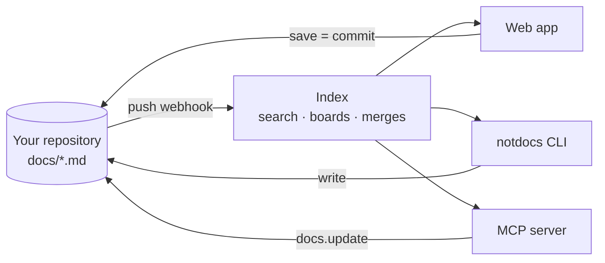

## What notdocs is

A notdocs workspace is a folder of markdown files in a git repository. Each file is a document. The web app edits those files, the `notdocs` CLI edits them, and a coding agent edits them over MCP. There is no database of your content to keep in sync with the repository, because the repository is the content.

The hosted service at notdocs.dev reads and commits through a GitHub App. Locally, the same code runs as a daemon on your machine against any folder, with no account.

## Pick a path

::::cards
:::card[Hosted]{href="hosted.md" icon="branch"}
Sign in, install the GitHub App, pick a repository. Every save is a commit.
:::
:::card[Local]{href="local.md" icon="folder"}
The daemon and the CLI on your machine, against any folder, offline.
:::
:::card[Agents]{href="https://notdocs.dev/agents" icon="sparkle"}
Give Claude Code, Cursor or any MCP client the same workspace.
:::
:::card[CLI]{href="https://notdocs.dev/cli" icon="code"}
Every command, for a local folder or a hosted workspace.
:::
::::

## What is in a workspace

:::files
- docs/ the documents root, configurable
  - _templates/ one file per template
  - tasks/
    - annual-toggle.md type: task
  - launches/
    - pricing.md type: launch, with a query block
  - roadmap.md type: page
- .notdocs/
  - comments/ one YAML file per document that has threads
  - index/ the local daemon's index
- notdocs.config.json docs root, custom types, ignored paths
- CLAUDE.md a section for agents, appended by notdocs init
:::

The content model is described under [Documents](documents.md), [Query blocks](query-blocks.md) and [Comments](comments.md); the page over the file under [The editor](editor.md); how edits meet under [Editing together](editing-together.md) and [Branches and merges](branches.md).

:::note[One dialect everywhere]
The editor, the CLI and the MCP server all write through the same markdown pipeline, so a no-op save is a zero-line diff, and a file written by an agent looks like one written by a person.
:::
